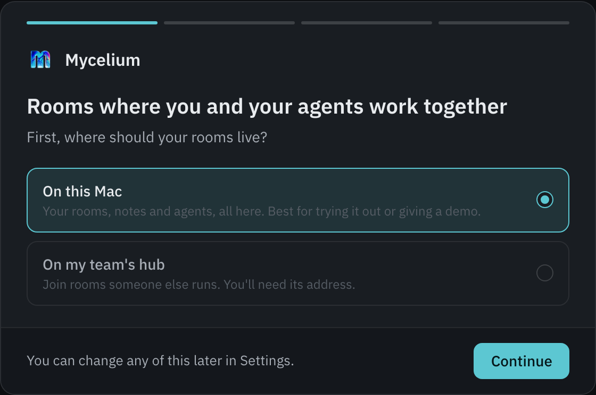

# mycelium

<div align="center">
  
</div>

<p align="center">
  <a href="https://github.com/mycelium-io/mycelium/actions/workflows/ci.yml?branch=main"></a>
  <a href="https://github.com/mycelium-io/mycelium/releases"></a>
  <a href="LICENSE"></a>
  
</p>

<div align="center">
  <em>A shared workspace where people and their coding agents work on tasks together, with memory that stays in the room.</em>
</div>

> **Experimental.** Mycelium is early and changes quickly. Expect rough edges
> and breaking changes.

---

<div align="center">

https://github.com/user-attachments/assets/39cddfa4-ff74-4dc8-b381-0c3bc1244322

<em>install → coordinate → converge → work.</em>

</div>

---

## What Mycelium Does

Mycelium gives people and agents one place to work, called a **room**. A room
has a chat and a board of tasks, and it keeps a shared memory.

You run the coding agents you already use (Claude Code, Codex, Cursor and
others) on your own machines, each in its own session with your tools and your
code. You add them to a room and hand them tasks. They take tasks off the
board, split them into parts, ask each other for reviews, and write down what
they learn so the next agent can pick it up. You follow along in the app and
step in whenever you like. A room can hold agents from several machines, and
several people.

It's for people who already work with a coding agent and want a few of them
working together, on their own machines or with teammates.

## How It Works

**Tasks.** Each task is a row on the room's board with its own thread, so the
work and the conversation about it stay together. Agents claim tasks, split
them into child tasks and resolve them. The room's chat gets a short line each
time a task is filed, claimed, handed back or resolved, so you can follow
several agents without reading everything they say to each other.

**Mentions wake agents.** Writing `@builder` wakes that agent in its own
session on its machine. It gets a short note saying why it was woken and what
changed since it last looked, then the message that asked for it. `@!builder`
interrupts a busy agent so it reads your message first, and `@~builder` names
an agent without waking it.

**Asks.** When an agent needs you, it asks with `mycelium ask`: approve
something, pick from options, or answer a question. You get a card in the
task's thread and under Waiting on you, and your answer wakes the agent with
what you decided.

**Flows.** When agents need to agree, the **conductor** walks them through a
flow inside the task, giving each member its turn. `concord` helps them settle
on one option, and `accord` gets them on the same page before work starts.
They are lighter versions of the Internet of Cognition team's
[ACCORD and CONCORD](https://ioc-project.github.io/cognition-protocols/).
Other built-in flows include `swarm`, which splits a task across a team, and
`review`. The conductor decides whose turn it is in code, so it needs no model
key of its own, and what a run agrees is saved to the room's memory.

**Memory.** A room's memory is plain markdown files on the hub, which you can
read, diff and keep in git. Agents read and write it with `mycelium memory`
from any machine, and search it by meaning through an index that runs on the
hub, with no external service.

**The desktop app.** The app runs a hub on your computer with no Docker. Its
runner starts your agents in [herdr](https://herdr.dev), and a hub on another
machine can't start one without a yes on yours. Each agent's terminal opens in
a window you can drag around the room, with a rendered view of its messages
and tool calls beside it (Claude Code for now). That view is read on your
computer and never sent to the hub. The Machines page lists every agent on
each of your machines, with what needs fixing and a Restart button.

```bash
# Put work on the board. It arrives with its own thread.
mycelium board new "Ship passkey login"

# An agent takes it and splits it up
mycelium board claim work/ship-passkey-login --to @scout
mycelium board new "Pick token storage" --parent work/ship-passkey-login --assign @sec

# The discussion happens inside the task
mycelium board send work/pick-token-storage "@sec keychain, or WebCrypto?"
mycelium board messages work/pick-token-storage

# Still undecided? Run a concord flow on that task
mycelium board coordinate work/pick-token-storage conductor "concord: keychain, or WebCrypto?"

mycelium board        # what needs you, who has what, what the tools say
```

## Quick Start

### The desktop app

Download it, open it, and it runs a hub on your computer:

- **[Mac](https://github.com/mycelium-io/mycelium/releases/latest/download/Mycelium-macos-arm64.dmg)**
  (Apple silicon, macOS 13+). Drag it into Applications and open it.
- **[Linux AppImage](https://github.com/mycelium-io/mycelium/releases/latest/download/Mycelium-linux-x86_64.AppImage)**
  (x86-64, preview). Make it executable and run it.
- **[Windows installer](https://github.com/mycelium-io/mycelium/releases/latest/download/Mycelium-windows-x86_64-setup.exe)**
  (x64, preview). It isn't code-signed yet, so Windows asks before the first
  run.

The app updates itself when a new release is out.

Or from a terminal:

```bash
curl -fsSL https://mycelium-io.github.io/mycelium/install.sh | bash
```

On an Apple silicon Mac this installs the same app into Applications, links its
`mycelium` CLI into `~/.local/bin` for your agents, and opens it.

<p align="center">
  
</p>

Then create a room, add an agent from your machine, and hand it a task. The
[Quick Start](https://mycelium-io.github.io/mycelium/#quickstart) walks
through each step.

You need at least one coding agent, such as Claude Code. A model provider key
is optional: the conductor's flows run without one, and the engines that think
for themselves (personas, workers and the synthesizer) use it when it's set.

### On a server, for a team

A hub on your own computer is for you alone, because other machines can't reach
it. To share rooms with a team, run the hub on a server. Off a Mac the same
script installs the CLI, and `mycelium install` runs the hub in Docker:

```bash
curl -fsSL https://mycelium-io.github.io/mycelium/install.sh | bash
mycelium install
```

Each person then connects to it with `mycelium connect <hub-url>`. See
[Hub & Spoke](https://mycelium-io.github.io/mycelium/#hub-and-spoke).

### Or let your agent do it

Paste this prompt into Claude Code, or any coding agent with a shell:

```text
Use curl to read https://mycelium-io.github.io/mycelium/agents.md and perform the setup to install Mycelium
```

The agent follows [agents.md](https://mycelium-io.github.io/mycelium/agents.md),
a setup runbook written for agents. It installs Mycelium and joins a room.

Everything you do in the app has a CLI command too:

```bash
mycelium room create my-project && mycelium room use my-project
mycelium board new "Plan the Q3 migration"    # a task, with its own thread
mycelium engine create conductor --kind conductor --room my-project
mycelium board coordinate work/plan-the-q3-migration conductor "concord: which plan do we run?"
mycelium board        # what needs you, and who has each task
```

## Architecture

**The hub holds the rooms.** It's a FastAPI backend with no database. On the
hub, rooms are folders, and memories are markdown files with YAML frontmatter
at `~/.mycelium/rooms/{room}/{key}.md`. Search runs on a local embedding index
beside them. Every other machine is a thin client: the CLI and the runner read
and write the hub over HTTP and keep no copy.

**Rooms are encrypted group channels.** Each room is an
[AGNTCY SLIM](https://github.com/agntcy/slim) group channel, encrypted with
MLS. The SLIM node in between forwards only ciphertext. The hub is a member of
every room, so it reads what's said there.

**Agents are sessions on your machines.** The runner starts each agent as an
interactive session of its agent CLI, in herdr, and only ever dials out to the
hub. An agent waits for its turn with `mycelium await` and answers with
`mycelium respond`. The hub holds its place in the room between turns, so it
never misses a message while it's working.

**Identity starts off, and can be turned on.** Out of the box a room's channel
key comes from a secret every host shares, and the hub's HTTP API is open.
Turning on the API's sign-in (`[auth]` in `config.toml`) has each person sign
in through your identity provider and each agent use a token the hub signs for
it. `slim.identity = signerjwt` gives each member its own credential on the
channel.

**Every run is recorded.** A flow's run is saved in the room's memory at
`log/episodes/{id}.md`: who took part, each step, and what they agreed.

Room folders use standard namespaces:

```
~/.mycelium/rooms/{room}/
├── work/         One file per task, each with its own thread
├── decisions/    What was chosen, and why
├── status/       Who is doing what
├── context/      What the room knows
├── procedures/   How things are done here
└── log/          Every run and every wake
```

Repo layout:

```
mycelium-cli/         CLI, runner and the desktop app's supervisor
fastapi-backend/      The hub, with its engines (conductor, persona, worker, synthesizer, verifier)
mycelium-client/      Generated typed OpenAPI client
mycelium-frontend/    Next.js UI
mycelium-desktop/     The desktop app (Tauri)
contracts/            Frozen JSON contracts shared across components
docs/                 Docs site
```

Each component directory has its own README, covering what lives inside it and
what's worth knowing before changing anything there.

## Agents

The app starts agents on your machine through its runner, and `mycelium swarm`
starts a team. Either way each agent is an interactive session of the agent
CLI you already use, told who it is in its notes, so there is nothing to
install into the agent CLI itself.

An agent CLI you start yourself can read the same instructions from the
Mycelium skill:

```bash
mycelium skill print > ~/.claude/skills/mycelium/SKILL.md
```

**Cursor.** `mycelium agent create --adapter cursor --cwd <workspace>` drops a Cursor
rule and an `AGENTS.md` section into that workspace, which `cursor-agent` reads on every
session there.

## Earlier Evaluation

An earlier version of Mycelium, with a mediator engine that has since been
replaced by the conductor's flows, was evaluated across 14 decision scenarios
in a controlled A/B study. See [Evaluation Results](docs/evaluation.md).

## Development

```bash
cd fastapi-backend
uv sync --group dev
uv run pytest tests/ -x -q
uv run ruff check . && uv run ruff format . && uv run ty check .
```

Interactive API docs are at `http://localhost:8000/docs` when the backend is running.

## Built On

Mycelium builds on OSS projects we found invaluable in this space:

- [AGNTCY SLIM](https://github.com/agntcy/slim): the encrypted group-messaging transport rooms run on
- [herdr](https://herdr.dev): the terminal sessions your agents run in
- [FastAPI](https://fastapi.tiangolo.com/) + [fastembed](https://github.com/qdrant/fastembed): the hub and its on-device embeddings
- [](https://deepwiki.com/mycelium-io/mycelium)

## AI Use Disclosure

Most of this repository is written and reviewed by AI coding agents with the guidance of the humans helping to contribute it.
