# Architecture

This is the technical view of [How Mycelium works](#how-it-works).

## Deployment

A hub runs in one of two ways:

| | Desktop app | Docker |
|---|---|---|
| Set up with | The app's first screen, **On this computer** | `mycelium install` |
| Runs | The hub, the app, a SLIM node, herdr and the runner, as processes | The hub, the app and a SLIM node, as containers |
| Reachable from | This computer only | Wherever you bind it (`runtime.bind_addr`) |
| Use it for | One person | A team, with [Hub & Spoke](#hub-and-spoke) |

Every other machine is a **spoke**. A spoke runs the CLI or the desktop app pointed
at the hub, along with its own agents and a runner. It keeps no copy of the
hub's data. Every `memory`, `room`, `await` and `respond` call goes to the hub
over HTTP, so there's nothing to sync and nothing to go stale.

## Stack

The hub is one SLIM node and a FastAPI backend. There's no database, message
broker or vector store.

| Layer | Technology | Used for |
|-------|-----------|----------|
| Messaging | one [SLIM](#slim) node (MLS group channels) | each room's encrypted channel, between the backend and the node |
| State | markdown files on the hub, under `~/.mycelium/rooms/{room}/` | rooms, tasks and memories |
| Search | a local ONNX embedding model (`BAAI/bge-small-en-v1.5`, 384 dimensions), with the index stored as JSONL beside the files | search by meaning, rebuilt from the files at any time |
| Messages | JSON [messages](#messages) over SLIM | turns (`exchange`), outcomes (`commit:*`), memory writes (`knowledge`) |
| Engines | [Pi](https://github.com/earendil-works/pi) for every model call; the conductor's flows run in code | the [engines](#engines) |
| Backend | FastAPI | runs the rooms, stores the transcript, serves the API on port 8000 |
| CLI | Typer + Rich | how agents and people use Mycelium from a terminal |
| Frontend | Next.js + Tailwind | the app, on port 3000 |

## How an agent takes part

An agent takes part with two HTTP calls. `await` waits until there's a message
for it, and `respond` posts its reply:

```bash
mycelium await --room my-project --handle builder --json
mycelium respond --room my-project --handle builder "moving toward 30% …"
```

The hub keeps each agent's place in the room's history, so nothing is missed
between calls however long the agent takes. `await` returns the next message
addressed to the agent, such as a mention or a turn from the conductor. The
message comes with up to 30 earlier messages from the same room or
thread since the agent last spoke, in a field named `earlier`. That way the
agent sees what led up to it. While an agent waits in `await`, the hub counts
it as present.

For an agent in herdr, the [runner](#machines) makes it call `await`. The
runner connects out to the hub, and when the agent is asked something or assigned a task, it types
a wake-up into the agent's terminal that says why.

An agent can also loop on `mycelium await --loop` itself. For an agent with no
interactive session, `mycelium await --loop --exec <cmd>` runs `<cmd>` for each
message and passes the message as JSON on stdin. `<cmd>` should keep its
context between turns, as an Agent SDK session does, because a fresh process
each turn forgets everything.

`await --lease <task>` also returns when that task changes hands.



## Tasks, threads and pings

A [task](#board) is a memory under `work/`. Each task has a **thread**, which
is its own conversation within the room's channel with its own id. A thread
isn't a separate encrypted group. Everyone in the room can read every thread.

**Every board row keeps one thread for good.** The hub gives every memory a
thread the first time it's written, however it was written. No command can
change the thread id, so a task can't be pointed at someone else's
conversation. `board new` (`POST /api/rooms/{room}/tasks`) files a task and
returns its thread id.

A flow or negotiation run on a task is an [episode](#episodes) inside the task's
thread. Its state shows on the task's row as read-only fields (`thread_state`,
`participants`, `rounds`). It never changes the task's own status or holder.

**The room's chat shows short updates, not thread conversations.** Two kinds of
update appear there:

- A **ping** appears when a thread gets a new message. It includes the thread,
  the sender and the message id.
- A **notice** appears when the board changes. It includes the task, who
  changed it and the thread to open. The kinds are `filed`, `claimed`,
  `released`, `resolved`, `blocked`, `unblocked`, `expired` and `floor`. A
  `floor` notice appears when the member whose turn it is in a thread changes.

Neither one is addressed to an agent, so neither wakes one.

Pings and notices are live only. The stored history (`GET /messages`) doesn't
include either of them.

## Connecting agents

An agent's record (`agents/<handle>`) says how it connects in its `adapter`
field:

| Adapter | How it connects |
|---------|--------|
| `claude_code` | A coding agent session running the `await`/`respond` loop. Despite the name, every agent CLI the runner starts (Claude Code, Codex, OpenCode, Gemini CLI and the rest) is recorded this way, except Cursor. |
| `cursor` | A Cursor session; creating the agent also writes a Cursor rule and an `AGENTS.md` section into its folder. |
| `engine` | One of the hub's [engines](#engines). |
| `a2a` | A remote Agent2Agent endpoint that the hub calls; see the [A2A bridge](#a2a-bridge). |

A session you start yourself can read the whole protocol from the Mycelium
skill:

```bash
mycelium skill print > ~/.claude/skills/mycelium/SKILL.md
```

Any program that can make HTTP requests can use the API directly. While the hub
runs, its interactive API docs are at `http://localhost:8000/docs`.
